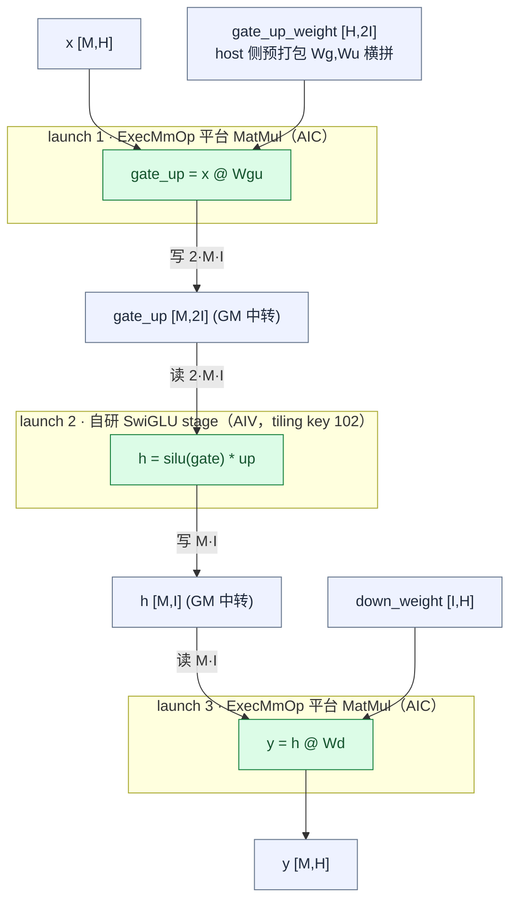
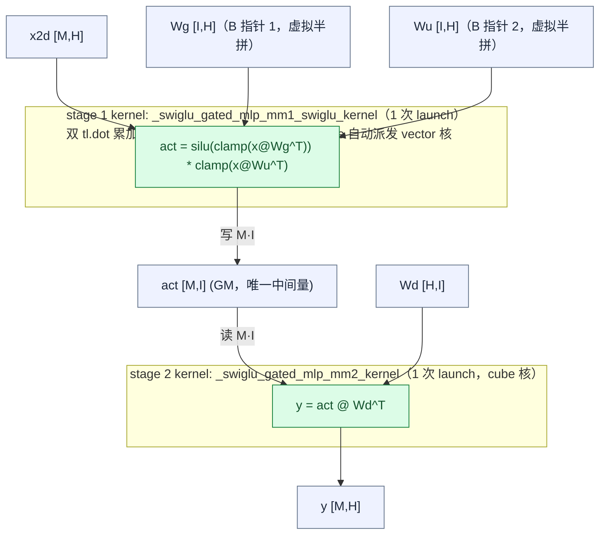
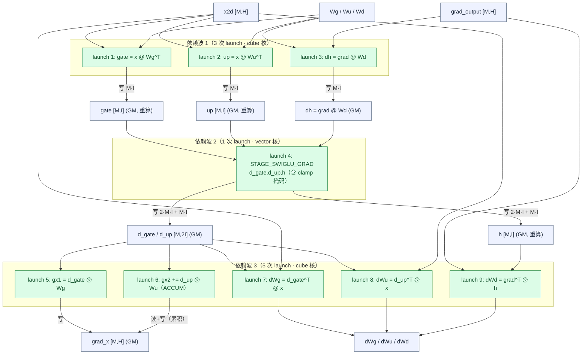
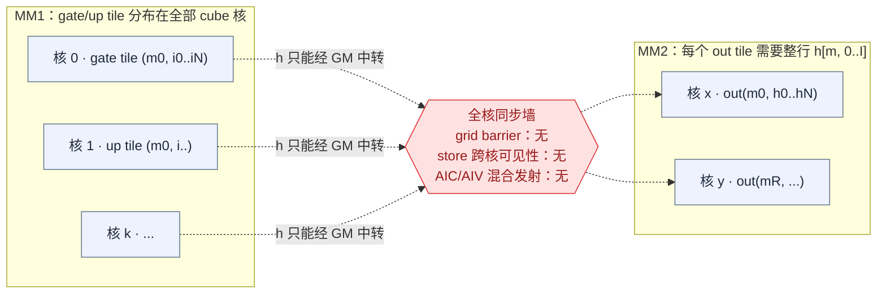
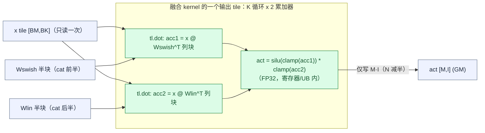
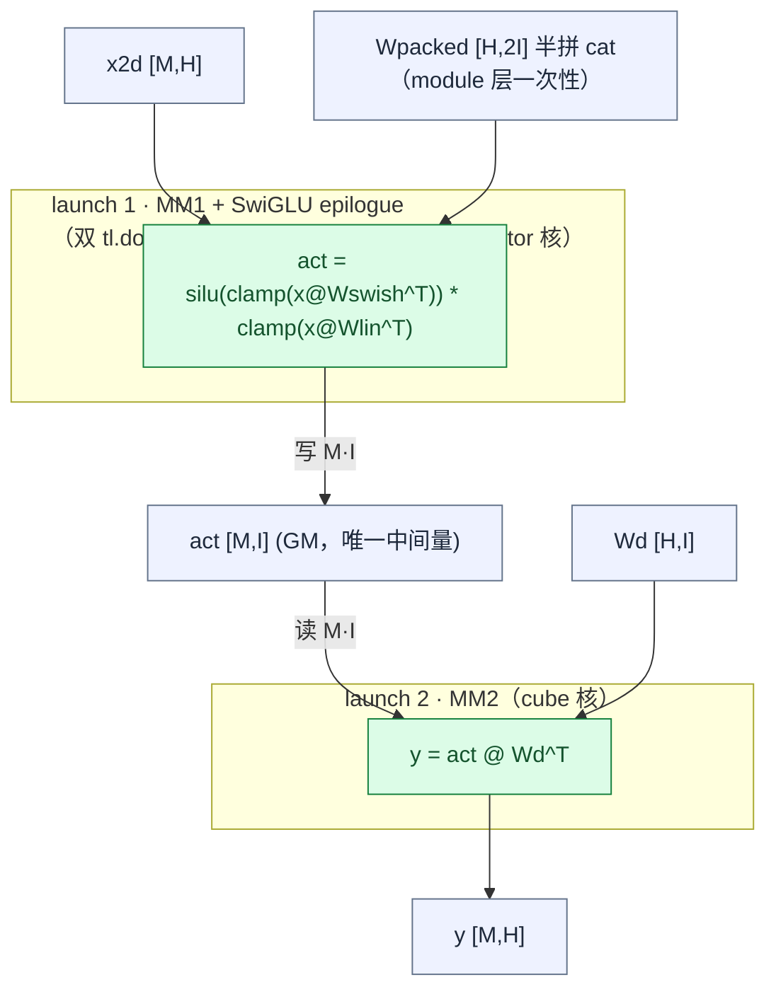

# SwiGLU Gated MLP 融合算子分析

> **历史记录**：`swiglu_gated_mlp` 已重构为 `gmm_swiglu_quant`（去除第二次
> mm、MXFP8 输入输出、融合量化，参考 ops-transformer
> `gmm/grouped_matmul_swiglu_quant_v2`；A2 无 fp8 dot_scaled 支持已移除）。
> 本文的双 dot 片上 epilogue、tile 预算模型与 C/V 派发结论被新算子继承。

> 基线：`npu_kernels_dev` @ `3ccf5be`（`swiglu_gated_mlp`，triton-ascend 3.6.0 / Ascend 950PR）
> 参考实现：`ops-transformer/experimental/ffn/swiglu_gated_mlp`（AscendC）
> 模型场景：glm-5.3（H=6144, I=12288 dense / 2048 shared，无 clamp）、glm-5.3-flash（H=4096, I=12288 / 2048, swiglu_limit=10.0）
>
> **范围更新（2026-11-04）：算子当前仅保留前向；反向实现已整体移除。**
> §4.2 / §5.3 / §6.4 的反向内容保留作后续扩展参考，与当前代码不再一一对应。

## 1. 算子语义

```text
gate = x @ Wg^T                 # [M,H] @ [H,I]  -> [M,I]
up   = x @ Wu^T                 # [M,H] @ [H,I]  -> [M,I]
gate = clamp(gate, max=L)       # Glm5NextTextMLP；L=0 时关闭
up   = clamp(up, -L, +L)
h    = silu(gate) * up          # SwiGLU 激活
y    = h @ Wd^T                 # [M,I] @ [I,H]  -> [M,H]
```

反向需要输出全部四个梯度：`dx`、`dWg`、`dWu`、`dWd`（含 clamp 的闭区间梯度掩码）。**（反向已移除，暂缓实现；下述反向内容为设计参考。）**

## 2. 融合的四个层级（标尺）

| 层级 | 含义 | 参考实现（AscendC） | 当前实现（triton） | 可达目标（无平台修改） |
|---|---|---|---|---|
| L0 算子级 | 框架只见一个算子/一次调用 | ✅ 单 `SwigluGatedMlp` 算子 | ✅ custom op（compile/fake 遮蔽） | 保持 |
| L1 launch 级 | device 发射次数 | fwd 3 次 | fwd 2 次（P0 已实施，每阶段一 kernel） | 已达成 |
| L2 访存级 | 中间量是否落 GM | gate_up、h 落 GM | 仅 act 落 GM（P0 已实施） | 已达成 |
| L3 片上级 | 跨核共享片上内存 | ✗ | ✗ | 平台依赖（见 §5.2） |

## 3. 参考实现的计算流

参考实现的 ACLNN 路径是**算子级融合、launch 级不融合**：`aclnnSwigluGatedMlp` 内部展开为
3 次 device launch（`swiglu_gated_mlp_l0.cpp:145-155`）——两次平台 MatMul（`ExecMmOp`）夹一次自研
AIV SwiGLU stage。gate/up 合一靠 **host 侧权重预打包** `gate_up_weight [H,2I]`（布局手段，非 kernel 手段）。



参考实现里唯一的"单 launch 全融合"是 `WG_MLP_STAGE_FUSED`（stage=104，仅 fp32，
`swiglu_gated_mlp_impl.hpp:203-219`）：一个用 `GetValue/SetValue` 裸写的**标量三重循环**，
复杂度 `O(M·H·I·O)`。对 glm-5.3 dense prefill（M=4096）约 3.8 PFLOP，是分阶段实现
（6·M·H·I ≈ 1.86 TFLOP）的 **~2000 倍**——只能服务 toy 形状；其 tiling 中核数按行数封顶
（`swiglu_gated_mlp_tiling.cpp:463-464`）也印证它只做行并行。

**结论：参考实现的融合收益来自 ①算子级遮蔽 + ②gate/up 权重打包成单 GEMM + ③中间量最小化，
而不是把三个阶段塞进一次 launch。**

## 4. 当前实现计算流

P0 已实施：前向为**两个阶段 kernel、各一次 launch**（§6.2/§6.3 的方案）。历史的
"单 jit 入口 + STAGE 选择、4 次 launch"版本已被替换。反向已移除（§4.2 为历史记录）。

### 4.1 前向（P0 已实施：2 次 launch，每阶段一个 kernel）



前向中间量 GM 流量 **2·M·I**（act 写 + 读；gate/up 不落 GM）。glm-5.3 dense
prefill（M=4096, I=12288, bf16）约 **201 MB**/次前向，为 P0 前（6·M·I ≈ 604 MB）的 1/3。
两个阶段的 tile 配置**解耦**且由同一确定性规则计算（非 autotune），规则对齐 gmm
`grouped_matmul_swiglu_quant_v2` 的 tiling 方法论，按 triton 语义映射：**BLOCK_M/N/K
即 L1 级 tile 分配（A 片 + B 片），L0A/L0B/L0C 的细分由编译器完成、不建模**——
1. **形状定 base**（对应 `CalBasicBlock`）：`BM=⌈rows⌉₂`（cap 128）、BN 取 cap
   （stage-1 128 = 半拼 Wg|Wu 对上限，stage-2 256；stage-1 在 BM≤32 时窄化为 64，
   双 B 片挤占 staging 的补偿）；2. **L1 预算填 K**（对应 `CalL1Depth` 的 depth 填满）：
   `BK` 为 `(BM + num_B·BN)·BK·esize ≤ 预算` 内最大 2 的幂，预算 = L1/2
   （950 L1=512KB，另一半留给编译器 K 循环 double-buffer；fp32 因 esize 翻倍自动折半）；3.
   **decode 档**（对应小 M 路径门控）：rows≤16 走深 K（BK=512）窄 BN=64 的 GEMV 档。
   不做 underfill 强拆（gmm 的 `ReSplitBaseN` 仅在同波数下优化尾波；fresh 实测强拆
   从不取胜，如 mm2 rows=64 以 24/28 tiles 跑出最快 14µs）。经验约束：BN≥128 时
   BK≤256（MLIR 编译失败），BK 全局 ≤512。实际档位：decode (16,64,512)；rows=64
   stage-1 (64,128,256)、stage-2 (64,256,256)；rows≥128 stage-1 (128,128,256)、
   stage-2 (128,256,256)。a2 孪生同规则、预算 = UB/2 = 96KB（A2 经 UB staging），
   档位由预算模型给出（rows=64 档待真机验证）。

### 4.2 反向（已移除；历史设计为 9 次 launch，同一 kernel 入口）

> 反向已按当前范围移除，以下为移除前的设计记录，供后续恢复参考。



launch 6 的 `ACCUM` 累积需要 `grad_x` 的一次额外读+写（`+2·M·H`）；三个 wgrad 是对 M 的
全行归约，单一输出 tile 的 owner 核需要所有行——这正是它们必须独立成 stage 的原因（见 §5.1）。

## 5. 无法融合点定位

### 5.1 数学结构层：全核归约边界（换任何语言都绕不开）

三段之间是**全量归约依赖**，不是逐元素依赖：

- SwiGLU 需要同一 `i` 的 `gate[m,i]` 与 `up[m,i]`，各自是 **K=H 上的完整归约**；
- MM2 的每个输出 tile `out[m, h]` 需要整行 `h[m, 0..I]`——**K=I 上的完整归约**，该行带上
  所有 `(m,i)` tile 分属不同 cube 核。



把归约装进单核只有两条路，量化后都不可行（glm-5.3 dense, H=6144, I=12288, bf16，
三矩阵权重共 3·H·I·2B = 453 MB）：

| 路线 | 代价 | 结论 |
|---|---|---|
| a) 按 N-tile 重算 gate/up | MM1 FLOPs 放大 H/BN ≈ **48×**（BN=128） | 绝对不可行 |
| b) 行带独占（每核算完整行带） | 每核须流完全部 453 MB 权重；32 核共 **14.5 GB** DRAM 流量；利用率 = M/BM，M=1 decode → **1 核**（单核流 453 MB，按 ~50 GB/s 估 ~9 ms，而现状全核分流 0.55–0.76 ms） | 参考的 FUSED 玩具正是此路 |

结论：中间张量必须落 GM（或跨核共享片上内存），除非 `M·I·esize` 小到单核片上装得下
（M=8 时约 196 KB，仅 decode 量级，但 MM2 仍跨核，见 §5.2）。

### 5.2 平台层：triton-ascend 的能力边界（三个缺口 + 一项澄清）

| # | 缺口 | 实验证据 / 出处 | 影响 |
|---|---|---|---|
| 1 | 无 grid 级 barrier / 协作启动 | 自旋 barrier 原型：phase B 核读到 phase A 的**陈旧数据**（普通 store 跨核可见性无保证）；`atomic_xchg` 版本 **MLIR 编译崩溃**（backend bug）。`atomic_add` 虽有 `sem/scope` 形参，但对普通 load 的 acquire/release 缓存一致性链路未打通 | 无法把"分次 launch"压成"一次 launch 内部分阶段" |
| 2 | ~~单 launch 只能一种核型~~ **已澄清为非缺口**：含 `tl.dot` 的 kernel，dot 指令必然落在 cube 核；同 kernel 内的 vec 计算由编译器**自动派发到 vector 核**，且自动将 vec 任务切分为两份分到两个 vec 核（triton 层无感知） | 平台方确认（2026-11-04）；本仓探针复现：单 kernel 内双 `tl.dot` + SwiGLU vec epilogue 一次 launch 编译运行正确（附录） | epilogue 融合（§6.2）无需顾虑核型——gmm 用 `semaphore.h` 手工编排的 AIC↔AIV 协作，triton-ascend 编译器免费提供；不可做的只是手动核间编排 |
| 3 | 无跨核片上共享内存编程模型 | UB 每核私有，无 cluster/DSMEM 概念 | 跨核交换只能走 GM |
| 4 | 本算子的确定性约束（bitwise 可重复、float 禁 atomics） | 仓库测试契约 | 封死 atomic 归并做 split-K / wgrad 跨核累加，必须固定 owner 分次 staging |

### 5.3 反向多出的依赖边（反向已移除，暂缓）

bwd 即使有 grid barrier 也至少需要 **3 次全核同步**：

1. `dh = grad @ Wd` 与 gate/up 重算完成 → 才能算 SwiGLU 梯度（逐元素，但输入是三个全量 GEMM 结果）；
2. `d_act` 完成 → 才能算 `dx = d_act @ Wgu`（K=2I 归约）；
3. `d_act`/`h` 完成 → 才能算三个 wgrad（对 M 的全行归约）。

## 6. 无需平台修改即可取得的融合（可实施目标）

关键观察：**真正卡死的只有 §5.1/§5.2 那条全核同步线**；其余边界都能用布局手段消掉。

### 6.1 权重预打包 `Wgu = [Wg | Wu]`

module 层一次性打包（HF state-dict 加载后重排，反向边界处拆回），收益：

- fwd 的 gate/up 两次 GEMM → **一次**（4→3 launch，与参考一致）；
- bwd 的 `dx = d_gate@Wg + d_up@Wu` 数学上就是分块 GEMM：`dx = [d_gate | d_up] @ [Wg; Wu]`
  → **一次 GEMM**，省掉 launch 6 及其 `+2·M·H` 的累积读+写；
- bwd 的 gate/up 重算 → 一次。

> **实施说明（P0）**：stage-1 kernel 直接接收 `Wg`/`Wu` 两个 B 指针（**虚拟半拼**），
> 物理 `cat` 与 module 改造均不需要，HF 权重布局原样保留；其余打包收益均属反向，随反向暂缓。

### 6.2 MM1 epilogue 融合 SwiGLU（gate/up 不落 GM）

打包权重**沿 N 半拼**：`Wpacked = cat([Wswish, Wlin])`（即参考实现的 `[W_act | W_gate]` 布局，
普通 `torch.cat`、严格可逆）。融合 kernel 按输出（N/2）空间枚举 tile，每个 tile 的 K 循环里
**发射两次 `tl.dot`、共享同一 A tile 加载**——一次归约到 swish 半块、一次到线性半块——随后在
片上缓冲内完成 `silu(clamp(acc1)) * clamp(acc2)`，只写 N/2 列：



对比"列交错 + `tl.split`"备选（曾考虑，triton 3.6 原语可用）：半拼不需要 host 侧 interleave
重排，也没有跨步寄存器访问；访存上 A 只读一次、C 写减半、B 流量与两次独立 GEMM 相同——
**严格不劣于未融合**。代价是同时驻留两个 FP32 累加器（`2·BM·BN·4B`），必要时将 `BLOCK_N`
减半（仍是确定性 tile 选择，无 autotune）。同一半拼布局还直接服务 §6.1 的 dx 单 GEMM 与
bwd 的 gate_up 重算，`cat/split` 一种布局通吃全部融合点。

gate/up 从此不落 GM（前向）；数值上更贴 fp32 oracle（gate/up 不再经历 I/O dtype 的中间舍入），
确定性不受影响。**核型由编译器自动混合**：kernel 内两个 `tl.dot` 落 cube 核，SwiGLU 激活的
vec 部分由编译器自动派发到 vector 核（vec 任务自动二分到两个 vec 核，triton 无感知）——已在本仓
探针验证（附录）。这条路线已被 `ops-transformer/gmm` 的成品实现验证（见 §6.5）。

### 6.3 目标前向（2 次 launch）——已实施



| 指标 | P0 前（4 launch） | 实施后（2 launch） |
|---|---|---|
| 中间量 GM 流量 | 6·M·I ≈ 604 MB（M=4096 prefill） | **2·M·I ≈ 201 MB**（Δ≈403 MB/次前向，按 1.5–2 TB/s 约 200–270 µs） |
| device launch | 4 | 2 |
| gate/up 落 GM | 是 | 否 |

实施：`mojo_opset/kernels/npu_a{2,5}_triton/swiglu_gated_mlp.py`——两个阶段 kernel
（`_swiglu_gated_mlp_mm1_swiglu_kernel` / `_swiglu_gated_mlp_mm2_kernel`），tile 配置
**按阶段解耦**、由 gmm 式确定性规则计算（形状定 base + L1/2 预算填 BK + decode 档；
实际档位 a5 bf16：stage-1 decode (16,64,512) / rows=64 (64,128,256) / rows≥128
(128,128,256)，stage-2 decode (16,64,512) / rows=64 (64,256,256) / rows≥128
(128,256,256)；fp32 由预算自动折半，a2 同规则、预算 UB/2）。
warm e2e 实测（950PR，bf16，vs 4-launch 旧版）：decode(M=1, 6144/12288) 681→**340 µs**
（−50%）、shared(64×6144×2048) 109→**60 µs**（−45%）、prefill(512×4096×12288)
746→**533 µs**（−29%）、prefill(512×6144×12288) 1049→**764 µs**（−27%）、
full-batch(4096×4096×12288) **3548 µs**（超 torch-aclnn 组合 3982 µs 约 12%）、
flash shared(512×4096×2048) **101 µs**（追平 torch 103.5 µs）。

### 6.4 目标反向（暂缓；曾规划 7 次 launch，或 6）

```text
launch 1: dh    = grad @ Wd                       (GEMM)
launch 2: 重算 MM1 + epilogue，同时落 gate_up(交错) 与 h   (GEMM+epilogue)
launch 3: d_act = swiglu_grad(gate_up, h, dh)     (vector, 含 clamp 掩码；输出交错布局)
launch 4: dx    = d_act @ Wgu'^T                  (单次 GEMM，K=2I 归约)
launch 5: dWd   = grad^T @ h                      (GEMM)
launch 6: dWg   = d_gate^T @ x                    (GEMM)
launch 7: dWu   = d_up^T @ x                      (GEMM)
```

若允许 wgrad 以打包布局返回（`(dWg|dWu)` 交错 `[2I,H]`，在 autograd 边界处由 AIV 一次
de-interleave 拆回），launch 6/7 可合并为 `dWgu = d_act^T @ x`，共 **6 次**。
当前 9 次 → 7/6 次，且省掉 dx 的累积往返。

### 6.5 参考证据：`ops-transformer/gmm` 的 SwiGLU epilogue 成品实现

`gmm/grouped_matmul_swiglu_quant_v2`（GroupedMatmul + SwiGLU + 量化，README 明确
"**默认为确定性实现**"）正是 §6.2/§6.3 路线的工程化范本，四个机制与出处：

| 机制 | 出处 | 对本方案的启示 |
|---|---|---|
| **半拼 + tile 配对双 MMAD**：调度器按输出（N/2）空间枚举 tile；每个 tile 先算左块（act 半）再算右块（`bRightOffsetStep_` 跳到 gate 半），A tile 共享，结果分别进两个 L0C→UB 缓冲 | `common/cgmct/kernel/kernel_gmm_swiglu_hif4quant.h:350-380` | triton 的"双 `tl.dot` 累加器"方案与此同构；半拼 `cat` 打包即可，无需 interleave |
| **epilogue 内 FP32 SwiGLU 链**：`swish(first) ⊙ second` 在 FP32 上做，结束时一次 cast 到 I/O dtype | `common/cgmct/epilogue/block_epilogue_dequant_swiglu.h` | 与我们"FP32 链 + 单次舍入"的数值策略一致 |
| **AIC↔AIV 同 launch 协作**：union kernel 内 AIC 发射两个 MMAD 后 `NotifyVector()`，AIV `WaitForCube()` 后跑 epilogue，PING/PONG 双缓冲流水 | `common/cgmct/kernel/semaphore.h` | 对应 triton-ascend 的**自动核型混合**（dot→cube、vec 自动派发，§5.2-#2）：epilogue 场景 triton 免费获得；手工编排的价值仅在 P2 的跨 stage 流水（仍需 grid barrier） |
| **950PR fixpipe `DUAL_DST_SPLIT_N`**：L0C→UB 搬运时硬件将 tile 按 N 拆分写入两个 UB 目的 | `common/cgmct/tile/copy_out/copy_out_split_n_with_params.h` | triton 无此硬件分裂原语；双累加器方案不需要它（半块各自成 dot） |

该算子的输出即 `(M, N/2)`（SwiGLU 后 N 减半落盘）、确定性 tile 单写者结构与我们的约束完全一致。


## 7. 结论与路线图

> **当前无法融合的点 = 一条数学上必须的全核归约边界（act 的生产与消费横跨所有 cube 核）
> × 平台缺失的两个能力（grid 级 barrier 与 store 可见性、跨核片上共享内存），
> 外加本算子自加的确定性约束（float 禁 atomics）。
> 核型混合不是缺口：dot/vec 由编译器自动分派到 cube/vector 核（§5.2-#2）。**
> 参考实现同样跨不过这条线（它也是 3 次 launch，其单 launch FUSED 变体是 ~1000× FLOPs 的玩具）；
> 它能拿到的融合收益——权重打包 + 中间量最小化——我们尚有 2~7 个 launch 的压缩空间可无代价获得。

| 阶段 | 内容 | 依赖 | 收益 |
|---|---|---|---|
| P0 | 权重半拼 + 双累加器 epilogue 融合（§6.1–6.5） | **已完成**：虚拟半拼（双 B 指针）+ 两阶段 kernel，fwd 4→2 launch | fwd 4→2 launch ✅、中间量流量 −67% ✅；数值更贴 fp32 oracle（gate/up 无 I/O 舍入） |
| P1 | decode 专项：小 M 时 act 驻留片上的两段式 | 需跨核（MM2 归约仍跨核）→ 实际仍被平台卡住，暂缓 | — |
| P2 | 单 launch 全融合（stage 间 grid barrier） | 平台：grid barrier + store 可见性 + 跨核片上共享（核型混合已由编译器自动完成，见 §5.2-#2） | 消灭 launch 与同步开销 |

### 附：实验与出处证据

- P0 已实施：`mojo_opset/kernels/npu_a{2,5}_triton/swiglu_gated_mlp.py`（fwd 2 launch，虚拟半拼双 B 指针 + 双 `tl.dot` 累加器 + 自动派发 vec epilogue；**两阶段解耦的确定性 tile 规则**——gmm 式"形状定 base + L1 预算填 BK + decode 档"，对齐 grouped_matmul_swiglu_quant_v2 的 CalBasicBlock/CalL1Depth 方法论，BLOCK_M/N/K 按 L1 分配语义建模、L0 细分归编译器；950PR fresh 交错扫描校准，非 autotune）；
- 平台特性（平台方确认，2026-11-04）：含 `tl.dot` 的 triton kernel，dot 指令必然在 cube 核执行；vec 计算由编译器自动派发到 vector 核，并将 vec 任务自动切分为两份分到两个 vec 核（triton 层无感知）。本仓探针复现：单 kernel 内**双 `tl.dot` 累加器 + SwiGLU vec epilogue（clamp/sigmoid/mul）一次 launch**，覆盖 decode(M=1)/prefill(M=512)/尾块(37×1024×768) × bf16/fp32/fp16 × clamp 开/关 全部数值正确（fp32 逐位一致，bf16 ~3e-3 为 I/O 舍入）；
- gmm 半拼双 MMAD：`gmm/common/cgmct/kernel/kernel_gmm_swiglu_hif4quant.h:350-380`（左/右块 + `bRightOffsetStep_`）；FP32 swish epilogue：`gmm/common/cgmct/epilogue/block_epilogue_dequant_swiglu.h`；AIC↔AIV ping-pong：`gmm/common/cgmct/kernel/semaphore.h`；硬件 N 分裂：`gmm/common/cgmct/tile/copy_out/copy_out_split_n_with_params.h`；确定性声明：`gmm/grouped_matmul_swiglu_quant_v2/README.md`（"默认为确定性实现"）；
- 参考 3-launch 展开：`op_host/op_api/swiglu_gated_mlp_l0.cpp:145-155`（`ExecMmOp` → `AddSwigluStage` → `ExecMmOp`）；
- FUSED 标量玩具：`op_kernel/swiglu_gated_mlp_impl.hpp:165-226`（stage 常量见 `swiglu_gated_mlp_stage.h:23-26`）；
- 核型分离：`op_kernel/swiglu_gated_mlp.cpp:106-117`（`KERNEL_TASK_TYPE` AIC_ONLY/AIV_ONLY）；
- 自旋 barrier 陈旧读 / `atomic_xchg` MLIR 崩溃：本仓库前置实验（npu_kernels_dev2 阶段）；
- `tl.split` / `tl.interleave` / `tl.reshape`：triton-ascend 3.6.0 已确认存在；
- 现状性能（冷 L2 e2e 中位数，bf16）：fwd decode(M=1, 6144/12288) 760 µs、prefill(512) 1.05 ms、
  prefill(4096) 7.39 ms；torch（aclnnMatmul 组合）对应 302 µs / 0.69 ms / 6.89 ms——差距主体在
  GEMM stage 的基础分块（未调优，属预期）。
